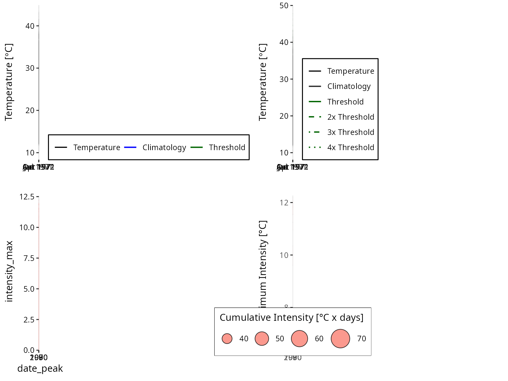
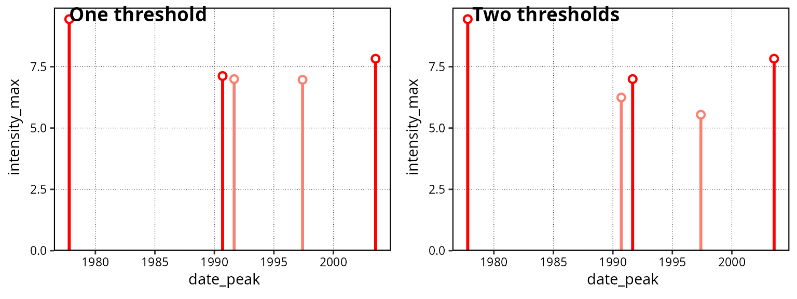

# Alternative Thresholds

## Overview

The **`heatwaveR`** package was designed to include many different
methods for the creation of climatologies and thresholds for detecting
extremes events (e.g. heatwaves and cold-spells) in time series data. To
this end we made a very large change in the event detection pipeline
when we moved from the **`RmarineHeatWaves`** package to
**`heatwaveR`**. This change may primarily be seen with the inclusion of
the
[`ts2clm()`](https://robwschlegel.github.io/heatwaveR/reference/ts2clm.md)
function and the removal of the climatology performed in
`RmarineHeatWaves::detect()` in favour of
[`detect_event()`](https://robwschlegel.github.io/heatwaveR/reference/detect_event.md),
which does not calculate climatologies. In this way we have allowed for
the introduction of a multitude of more complex climatology calculation
and event detection/filtering methods. It is our overarching goal to
provide one package that allows climate scientists to calculate these
events in both the atmosphere and oceans. But rather than talking about
it, let’s walk through some case studies on how this package can be used
for diverse applications.

## Double thresholds

Brought to our attention by Mr. Haouari from the Hydrometeorological
Institute of Training and Research (IHFR) in Algeria was the concept of
using a flat (e.g. 19$`^\circ`$C) `tMin` bottom boundary when
calculating events from `tMax` with the standard 90th percentile upper
threshold. As the authors of the **`heatwaveR`** package are admittedly
marine oriented, we tend to work with daily time series that have only
one mean value per day (e.g. `tMean`, `temp`, `sst`). This is why there
are not arguments in the **`heatwaveR`** suite of functions that call on
`tMin` and `tMax` explicitly, but that does not mean that one cannot do
so. Below we will work through the steps one would take to calculate
(atmospheric) heatwaves, as per their definition in Perkins and
Alexander (2013) (but excluding the calculation of EHF), and with the
additional step proposed by Mr. Haouari.

The following sub-sections will show the step-by-step process one may
use to calculate atmospheric heatwaves using a 90th percentile threshold
created from the `tMax` time series for a location, but will only use
the days when the corresponding `tMin` also exceeds a pre-determined
flat bottom boundary on the same days to quantify the heatwave metrics.
We will finish by visualising the results with the built-in
**`heatwaveR`** graphing functions of
[`event_line()`](https://robwschlegel.github.io/heatwaveR/reference/event_line.md)
and `lolli_plot` as well as a bubble plot. The data we will use for
these examples will be a 45 year time series of daily atmospheric `tMin`
and `tMax` temperatures over Algiers, Algeria contributed by
Mr. Haouari.

### Data prep

The first step with any analysis in R should be the loading of the
packages to be used.

``` r

library(dplyr)
library(ggpubr)
library(heatwaveR)
```

With our libraries loaded, we will now go about explicitly calling the
`Algiers` data into our environment. These data are automatically loaded
for us when we load the `heatwaveR` library, but we perform this step
here just for clarity. Anyone following along should feel free to use
whatever data they would like. As long as the data have a date (`t`),
`tMin`, and `tMax` column this code will function as designed.

``` r

Algiers <- Algiers
```

### Calculating thresholds

With our libraries and data loaded, we will now calculate the two
thresholds we need to correctly detect the heatwaves and accurately
quantify their metrics. The first is the 90th percentile threshold based
on the `tMax` time series. The second is the flat exceedance of
19$`^\circ`$C based on the `tMin` data. We use 19$`^\circ`$C as the
bottom threshold as this is roughly the mean `tMin` for summer
temperatures.

``` r

# The tMax threshold
# The current WMO standard climatology period is 1981-01-01 to 2010-12-31 and should be used when possible
# We rather use 1961-01-01 to 1990-01-01 as this is the oldest 30 year period available in the data
tMax_clim <- ts2clm(data = Algiers, y = tMax, climatologyPeriod = c("1961-01-01", "1990-12-31"), pctile = 90)

# The tMin exceedance
# Note the use here of 'minDuration = 3' and 'maxGap = 1' as the default atmospheric arguments
# The default marine arguments are 'minDuration = 5' and 'maxGap = 2'
tMin_exc <- exceedance(data = Algiers, y = tMin, threshold = 19, minDuration = 3, maxGap = 1)$threshold
```

### Calculating events

Now that the two thresholds have been calculated we use the
[`detect_event()`](https://robwschlegel.github.io/heatwaveR/reference/detect_event.md)
function as usual, but provide the second threshold to the argument
`threshClim2` that would normally lay dormant.

``` r

# Note that because we calculated our 90th percentile threshold on a column named 'tMax' 
# and not the default column name 'temp', we must specify this below with 'y = tMax'
events <- detect_event(data = tMax_clim, y = tMax, # The 90th percentile threshold
                       threshClim2 = tMin_exc$exceedance) # The flat exceedance threshold
```

Please note that even though the use of the second threshold does allow
for the resultant event metrics to differ, the values themselves are
still being calculated against the seasonal climatology and daily
temperatures for the time series given to the 90th percentile threshold
calculation (in this case `tMax`) and so using a second threshold (in
this case `tMin`) won’t generally have much of an effect on the event
metrics. Rather it mostly screens out smaller or larger events depending
on how one chooses to set the threshold. In the case when an exceedance
threshold is chosen for a temperature that would typically only occur in
summer (e.g. 19$`^\circ`$C, as used here), one is also effectively
screening events by season. There are many use cases where this would be
desirable. For example, if one is only interested in events that would
occur during a season in which night time heat stress becomes an issue
for the young and elderly.

### Creating visuals

Even though we have used two thresholds to calculate our events, the
results are output the same as though only one threshold (default) were
used. This means that we may use the visualisation functions that come
with **`heatwaveR`** without any extra fuss.

``` r

# The code to create a bubble plot for the heatwave results
bubble_plot <- ggplot(data = events$event, aes(x = date_peak, y = intensity_max)) +
  geom_point(aes(size = intensity_cumulative), shape = 21, fill = "salmon", alpha = 0.8) +
  labs(x = NULL, y = "Maximum Intensity [°C] ", size = "Cumulative Intensity [°C x days]") +
  scale_size_continuous(range = c(1, 10), 
                        guide = guide_legend(title.position = "top", direction = "horizontal")) +
  theme_bw() +
  theme(legend.position = c(0.3, 0.12),
        legend.box.background = element_rect(colour = "black"))

# Don't forget to set 'event_line(y = tMax)'
ggarrange(event_line(events, y = tMax, metric = intensity_max),
          event_line(events, y = tMax, metric = intensity_max, category = T),
          lolli_plot(events),
          bubble_plot,
          ncol = 2, nrow = 2, align = "hv")
```



### Alternative second thresholds

Using a percentile based second threshold is not much different than
using a static second threshold. Rather than using
[`exceedance()`](https://robwschlegel.github.io/heatwaveR/reference/exceedance.md)
to get our second threshold we can use `ts2clm` nested within
[`detect_event()`](https://robwschlegel.github.io/heatwaveR/reference/detect_event.md).
It must also be pointed out that in addition to using multiple
thresholds, we can adjust the minimum duration (`minDuration`) and
maximum gap (`maxGap`) arguments for our multiple thresholds, too. This
allows us to provide different ‘flavours’ of criteria for our events.
For example, let’s say we are interested in night-time events (`tMin`)
when the temperatures remain above the 80th percentile threshold
(`pctile = 80`) for 10 or more days (`minDuration = 10`) without dipping
below that threshold for more than 2 consecutive days (`maxGap = 2`).
But on top of that, we are also only interested in those parts of the
event when the daytime temperatures exceed the 90th percentile threshold
(`pctile = 90`) for 3 or more days (`minDuration = 3`) non-stop
(`maxGap = 0`).

Below we will look at how to detect/calculate events that meet these
rather specific criteria. We will also calculate events with just the
first threshold and compare the results visually. It must be noted here
that whichever criteria is the most strict, in this case
`minDuration = 3` and `maxGap = 0`, will be the predominant filter
through which the event metrics are quantified.

``` r

# Note that because we are not using the standard column name 'temp' we must
# specify the chosen column name twice, once for ts2clm() and again for detect_event()

# First threshold based on tMin
thresh_tMin <- ts2clm(data = Algiers, y = tMin, pctile = 80, 
                      climatologyPeriod = c("1961-01-01", "1990-12-31"))

# Second threshold based on tMax
# Be careful here that you put the arguments within the correct brackets
thresh_tMax <- detect_event(ts2clm(data = Algiers, y = tMax, pctile = 90, 
                                   climatologyPeriod = c("1961-01-01", "1990-12-31")),
                            # These arguments are passed to detect_event(), not ts2clm()
                            minDuration = 3, maxGap = 0, y = tMax, protoEvents = T)

# Detect/calculate events using the two precalculated thresholds
# Because detect_event() is not able to deduce which arguments we used above,
# we must again tell it explicitly here
events_two_thresh <- detect_event(data = thresh_tMin, y = tMin, minDuration = 10, maxGap = 2,
                                  threshClim2 = thresh_tMax$event, minDuration2 = 3, maxGap2 = 0)

# Or to simply use one threshold
events_one_thresh <- detect_event(data = thresh_tMin, y = tMin, minDuration = 10, maxGap = 2)
```

Here are the differences in lolliplot format:

``` r

ggarrange(lolli_plot(events_one_thresh), lolli_plot(events_two_thresh), labels = c("One threshold", "Two thresholds"))
```



Here is a brief display of the top few events from each method:

``` r

head(events_one_thresh$event)
```

    ##   event_no index_start index_peak index_end duration date_start  date_peak
    ## 1        1        6135       6137      6144       10 1977-10-18 1977-10-20
    ## 2        2       10844      10845     10856       13 1990-09-09 1990-09-10
    ## 3        3       11191      11200     11201       11 1991-08-22 1991-08-31
    ## 4        4       13292      13300     13301       10 1997-05-23 1997-05-31
    ## 5        5       15534      15542     15546       13 2003-07-13 2003-07-21
    ##     date_end intensity_mean intensity_max intensity_var intensity_cumulative
    ## 1 1977-10-27         6.3138        9.4382        2.2112              63.1381
    ## 2 1990-09-21         4.8424        7.1201        1.1790              62.9507
    ## 3 1991-09-01         4.2121        6.9957        1.3819              46.3328
    ## 4 1997-06-01         5.1003        6.9670        1.4467              51.0026
    ## 5 2003-07-25         4.9539        7.8255        1.5317              64.4012
    ##   intensity_mean_relThresh intensity_max_relThresh intensity_var_relThresh
    ## 1                   3.7265                  6.8697                  2.2268
    ## 2                   2.1077                  4.3639                  1.1767
    ## 3                   1.5352                  4.2877                  1.3602
    ## 4                   2.3915                  4.3123                  1.4514
    ## 5                   2.4188                  5.3032                  1.5337
    ##   intensity_cumulative_relThresh intensity_mean_abs intensity_max_abs
    ## 1                        37.2652            19.1700              22.6
    ## 2                        27.4000            21.9538              24.6
    ## 3                        16.8871            22.6091              25.1
    ## 4                        23.9148            18.4400              20.7
    ## 5                        31.4441            23.6154              26.6
    ##   intensity_var_abs intensity_cumulative_abs rate_onset rate_decline
    ## 1            2.4454                    191.7     2.7282       0.8901
    ## 2            1.2474                    285.4     2.9576       0.3342
    ## 3            1.2169                    248.7     0.5665       2.5287
    ## 4            1.5284                    184.4     0.6922       3.4156
    ## 5            1.5737                    307.0     0.6559       1.2658

``` r

head(events_two_thresh$event)
```

    ##   event_no index_start index_peak index_end duration date_start  date_peak
    ## 1        1        6135       6137      6137        3 1977-10-18 1977-10-20
    ## 2        2       10851      10851     10856        6 1990-09-16 1990-09-16
    ## 3        3       11191      11200     11201       11 1991-08-22 1991-08-31
    ## 4        4       13292      13294     13294        3 1997-05-23 1997-05-25
    ## 5        5       15540      15542     15545        6 2003-07-19 2003-07-21
    ##     date_end intensity_mean intensity_max intensity_var intensity_cumulative
    ## 1 1977-10-20         7.8121        9.4382        1.6787              23.4362
    ## 2 1990-09-21         4.6254        6.2445        1.1706              27.7521
    ## 3 1991-09-01         4.2121        6.9957        1.3819              46.3328
    ## 4 1997-05-25         4.5271        5.5434        1.0897              13.5814
    ## 5 2003-07-24         5.5217        7.8255        1.6801              33.1301
    ##   intensity_mean_relThresh intensity_max_relThresh intensity_var_relThresh
    ## 1                   5.2521                  6.8697                  1.6710
    ## 2                   1.9070                  3.5148                  1.1701
    ## 3                   1.5352                  4.2877                  1.3602
    ## 4                   1.7688                  2.7948                  1.0998
    ## 5                   3.0012                  5.3032                  1.6827
    ##   intensity_cumulative_relThresh intensity_mean_abs intensity_max_abs
    ## 1                        15.7562            21.1000              22.6
    ## 2                        11.4419            21.4667              23.3
    ## 3                        16.8871            22.6091              25.1
    ## 4                         5.3064            17.4667              18.6
    ## 5                        18.0071            24.3167              26.6
    ##   intensity_var_abs intensity_cumulative_abs rate_onset rate_decline
    ## 1            1.5524                     63.3     2.7282       1.9769
    ## 2            1.1776                    128.8     0.9760       0.5396
    ## 3            1.2169                    248.7     0.5665       2.5287
    ## 4            1.2055                     52.4     1.7839       0.1172
    ## 5            1.7034                    145.9     0.7293       1.0585

If we look at these results we see that the use of two thresholds did
not detected fewer events than the use of one threshold. This is because
even though the second threshold was much more ‘difficult’ for the time
series to surpass than the first, the heatwaves in the time series are
so pronounced that they emerge regardless. This method allows for a lot
of flexibility, but users should also be cautious that they understand
what exactly they are asking their machines to do. In the case above, it
may be that we would actually prefer to calculate our event metrics
based entirely on the first threshold, but filter out the events that
didn’t meet our second threshold criteria. We will see how to do this in
the following section.

## Filtering with a second threshold

The methodology outlined below for the detection and filtering of events
with two thresholds is somewhat cumbersome. A potential issue with this
technique is that the multiple filters do not affect the calculation of
the event metrics (e.g. `intensity_cumulative`), as only the primary
threshold given to
[`detect_event()`](https://robwschlegel.github.io/heatwaveR/reference/detect_event.md)
is used when calculating event metrics. This may however be the desired
case if one is still interested in knowing the cumulative intensity
above the given percentile threshold, but only wants to filter the full
event based on some other threshold criteria. I can imagine real-world
use cases for both scenarios, which is why this seemingly less
sophisticated approach is detailed below.

### Filtering events

Because we have already calculated our single threshold events
(`events_one_thresh`) and our second threshold (`thresh_tMax`) we may
directly begin filtering the results. Before we do so, let’s pull out
the list components of our results into dataframes for easier use down
the line.

``` r

# Pull out each data.frame as their own object for easier use
events_one_event <- events_one_thresh$event
events_one_climatology <- events_one_thresh$climatology
```

This is where things may get tricky for some users, and where the
default use of the functions in the **`heatwaveR`** package ends. We are
now going ‘off-road’ so to speak. But do not despair! The
**`tidyverse`** suite of packages makes data wrangling like this much
more user friendly than it was in the dark days of Base R coding.

In order to make the filtering of events easier, we will combine the two
different dataframes that we are using as threshold/filtering guides to
chose the events that meet all of our selection criteria.

``` r

# Join the two threshold dataframes
two_thresh <- left_join(events_one_climatology, thresh_tMax, by = c("t"))

# Remove all days that did not qualify as events in both thresholds
two_thresh_filtered <- two_thresh %>%
  filter(event.x == TRUE,
         event.y == TRUE)
```

With our filtering guide created, we may now apply it to
`events_one_thresh` to get our filtered results.

``` r

# Copy data with a new name
events_one_thresh_filtered <- events_one_thresh

# Then filter
events_one_thresh_filtered$event <- events_one_thresh_filtered$event %>% 
  filter(event_no %in% two_thresh_filtered$event_no.x)

# Compare results
head(events_one_thresh_filtered$event)
```

    ##   event_no index_start index_peak index_end duration date_start  date_peak
    ## 1        1        6135       6137      6144       10 1977-10-18 1977-10-20
    ## 2        2       10844      10845     10856       13 1990-09-09 1990-09-10
    ## 3        3       11191      11200     11201       11 1991-08-22 1991-08-31
    ## 4        4       13292      13300     13301       10 1997-05-23 1997-05-31
    ## 5        5       15534      15542     15546       13 2003-07-13 2003-07-21
    ##     date_end intensity_mean intensity_max intensity_var intensity_cumulative
    ## 1 1977-10-27         6.3138        9.4382        2.2112              63.1381
    ## 2 1990-09-21         4.8424        7.1201        1.1790              62.9507
    ## 3 1991-09-01         4.2121        6.9957        1.3819              46.3328
    ## 4 1997-06-01         5.1003        6.9670        1.4467              51.0026
    ## 5 2003-07-25         4.9539        7.8255        1.5317              64.4012
    ##   intensity_mean_relThresh intensity_max_relThresh intensity_var_relThresh
    ## 1                   3.7265                  6.8697                  2.2268
    ## 2                   2.1077                  4.3639                  1.1767
    ## 3                   1.5352                  4.2877                  1.3602
    ## 4                   2.3915                  4.3123                  1.4514
    ## 5                   2.4188                  5.3032                  1.5337
    ##   intensity_cumulative_relThresh intensity_mean_abs intensity_max_abs
    ## 1                        37.2652            19.1700              22.6
    ## 2                        27.4000            21.9538              24.6
    ## 3                        16.8871            22.6091              25.1
    ## 4                        23.9148            18.4400              20.7
    ## 5                        31.4441            23.6154              26.6
    ##   intensity_var_abs intensity_cumulative_abs rate_onset rate_decline
    ## 1            2.4454                    191.7     2.7282       0.8901
    ## 2            1.2474                    285.4     2.9576       0.3342
    ## 3            1.2169                    248.7     0.5665       2.5287
    ## 4            1.5284                    184.4     0.6922       3.4156
    ## 5            1.5737                    307.0     0.6559       1.2658

``` r

head(events_two_thresh$event)
```

    ##   event_no index_start index_peak index_end duration date_start  date_peak
    ## 1        1        6135       6137      6137        3 1977-10-18 1977-10-20
    ## 2        2       10851      10851     10856        6 1990-09-16 1990-09-16
    ## 3        3       11191      11200     11201       11 1991-08-22 1991-08-31
    ## 4        4       13292      13294     13294        3 1997-05-23 1997-05-25
    ## 5        5       15540      15542     15545        6 2003-07-19 2003-07-21
    ##     date_end intensity_mean intensity_max intensity_var intensity_cumulative
    ## 1 1977-10-20         7.8121        9.4382        1.6787              23.4362
    ## 2 1990-09-21         4.6254        6.2445        1.1706              27.7521
    ## 3 1991-09-01         4.2121        6.9957        1.3819              46.3328
    ## 4 1997-05-25         4.5271        5.5434        1.0897              13.5814
    ## 5 2003-07-24         5.5217        7.8255        1.6801              33.1301
    ##   intensity_mean_relThresh intensity_max_relThresh intensity_var_relThresh
    ## 1                   5.2521                  6.8697                  1.6710
    ## 2                   1.9070                  3.5148                  1.1701
    ## 3                   1.5352                  4.2877                  1.3602
    ## 4                   1.7688                  2.7948                  1.0998
    ## 5                   3.0012                  5.3032                  1.6827
    ##   intensity_cumulative_relThresh intensity_mean_abs intensity_max_abs
    ## 1                        15.7562            21.1000              22.6
    ## 2                        11.4419            21.4667              23.3
    ## 3                        16.8871            22.6091              25.1
    ## 4                         5.3064            17.4667              18.6
    ## 5                        18.0071            24.3167              26.6
    ##   intensity_var_abs intensity_cumulative_abs rate_onset rate_decline
    ## 1            1.5524                     63.3     2.7282       1.9769
    ## 2            1.1776                    128.8     0.9760       0.5396
    ## 3            1.2169                    248.7     0.5665       2.5287
    ## 4            1.2055                     52.4     1.7839       0.1172
    ## 5            1.7034                    145.9     0.7293       1.0585

The event numbers found in `events_one_thresh_filtered` are the same as
the event numbers found in `events_two_thresh` with the important
difference that the event metrics in `events_two_thresh` were calculated
only on the days that exceeded both thresholds, while the events in
`events_one_thresh_filtered` have had their metrics calculated from all
of the days that exceeded only the first threshold.

### Visualising filtered events

To better understand how different the results from these two different
techniques may be we will use lolliplots to visualise them.

``` r

ggarrange(lolli_plot(events_two_thresh, metric = duration), 
          lolli_plot(events_one_thresh_filtered, metric = duration), 
          labels = c("Double threshold", "Filter threshold"))
```


Difference in duration (days) of events given different applications of
thresholds. Note the difference in the y-axes.

``` r

ggarrange(lolli_plot(events_two_thresh, metric = intensity_cumulative), 
          lolli_plot(events_one_thresh_filtered, metric = intensity_cumulative), 
          labels = c("Double threshold", "Filter threshold"))
```


Difference in cumulative intensity (°C x days) of events given different
applications of thresholds. Note the difference in the y-axes.

One may of course visualise the outputs from the events calculated here
with
[`geom_flame()`](https://robwschlegel.github.io/heatwaveR/reference/geom_flame.md)
and
[`geom_lolli()`](https://robwschlegel.github.io/heatwaveR/reference/geom_lolli.md)
as well, but this will not differ from the default method of using these
functions as outlined in their help files so we will not go into that
here.

## Summary

This vignette serves as a guideline for how to implement multiple
methodologies for using two thresholds (`tMin` and `tMax`) with
atmospheric data. We also showed in this vignette a more straight
forward approach to using a second threshold through the built-in
arguments in
[`detect_event()`](https://robwschlegel.github.io/heatwaveR/reference/detect_event.md).
The use of a second threshold in this way, whether it be based on a
static threshold or one derived from a percentile, is useful for the
consideration of events that may be more specifically relevant to a
given season or organism.

I hope the techniques shown in this vignette will be useful both
technically and theoretically. The authors of **`heatwaveR`** are very
happy to receive any further input on the development of the package as
well as other potential methods for calculating heatwaves and
cold-spells in air or sea.

## References

Perkins, Sarah E., and Lisa V. Alexander. 2013. “On the measurement of
heat waves.” *Journal of Climate* 26 (13): 4500–4517.
