# Basic Detection and Visualisation of Events

## Data

The
[`detect_event()`](https://robwschlegel.github.io/heatwaveR/reference/detect_event.md)
function is the core of this package, and it expects to be fed the
output of the second core function,
[`ts2clm()`](https://robwschlegel.github.io/heatwaveR/reference/ts2clm.md).
By default,
[`ts2clm()`](https://robwschlegel.github.io/heatwaveR/reference/ts2clm.md)
wants to receive a two-column dataframe with one column labelled `t`
containing all of the date values, and a second column `temp` containing
all of the temperature values. Please note that the date format it
expects is “YYYY-MM-DD”. For example, please see the top five rows of
one of the datasets included with the **`heatwaveR`** package:

``` r

head(heatwaveR::sst_WA)
```

    ## # A tibble: 6 × 2
    ##   t           temp
    ##   <date>     <dbl>
    ## 1 1982-01-01  20.9
    ## 2 1982-01-02  21.2
    ## 3 1982-01-03  21.4
    ## 4 1982-01-04  21.2
    ## 5 1982-01-05  21.3
    ## 6 1982-01-06  21.6

It is possible to use different column names other than `t` and `temp`
with which to calculate events. Please see the help files for
[`ts2clm()`](https://robwschlegel.github.io/heatwaveR/reference/ts2clm.md)
or
[`detect_event()`](https://robwschlegel.github.io/heatwaveR/reference/detect_event.md)
for a thorough explanation of how to do so.

Loading ones data from a `.csv` file or other text based format is the
easiest approach for the calculation of events, assuming one is not
working with gridded data (e.g. NetCDF). Please see [this
vignette](https://robwschlegel.github.io/heatwaveR/articles/gridded_event_detection.html)
for a detailed walkthrough on using the functions in this package with
gridded data.

## Calculating marine heatwaves (MHWs)

Here are the
[`ts2clm()`](https://robwschlegel.github.io/heatwaveR/reference/ts2clm.md)
and
[`detect_event()`](https://robwschlegel.github.io/heatwaveR/reference/detect_event.md)
function applied to the Western Australia test data included with this
package (`sst_WA`), which are also discussed by Hobday et al. (2016):

``` r

library(dplyr)
library(ggplot2)
library(heatwaveR)

# Detect the events in a time series
ts <- ts2clm(sst_WA, climatologyPeriod = c("1982-01-01", "2011-12-31"))
mhw <- detect_event(ts)

# View just a few metrics
mhw$event %>% 
  dplyr::ungroup() %>%
  dplyr::select(event_no, duration, date_start, date_peak, intensity_max, intensity_cumulative) %>% 
  dplyr::arrange(-intensity_max) %>% 
  head(5)
```

    ##   event_no duration date_start  date_peak intensity_max intensity_cumulative
    ## 1       52      105 2010-12-24 2011-02-28        6.5798             293.2107
    ## 2       41       35 2008-03-25 2008-04-14        3.8299              79.3307
    ## 3       29       95 1999-05-13 1999-05-22        3.6390             240.2994
    ## 4       60       14 2012-12-27 2012-12-31        3.4230              32.2560
    ## 5       59      101 2012-01-10 2012-01-27        3.3804             214.0509

## Visualising marine heatwaves (MHWs)

### Default MHW visuals

One may use
[`event_line()`](https://robwschlegel.github.io/heatwaveR/reference/event_line.md)
and
[`lolli_plot()`](https://robwschlegel.github.io/heatwaveR/reference/lolli_plot.md)
directly on the output of
[`detect_event()`](https://robwschlegel.github.io/heatwaveR/reference/detect_event.md)
in order to visualise MHWs. Here are the functions being used to
visualise the massive Western Australian heatwave of 2011:

``` r

event_line(mhw, spread = 180, metric = intensity_max, 
           start_date = "1982-01-01", end_date = "2014-12-31")
```

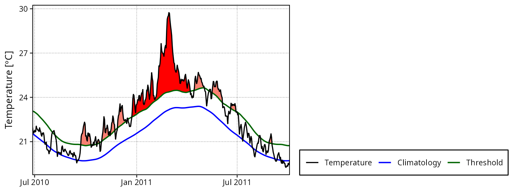

``` r

lolli_plot(mhw, metric = intensity_max)
```

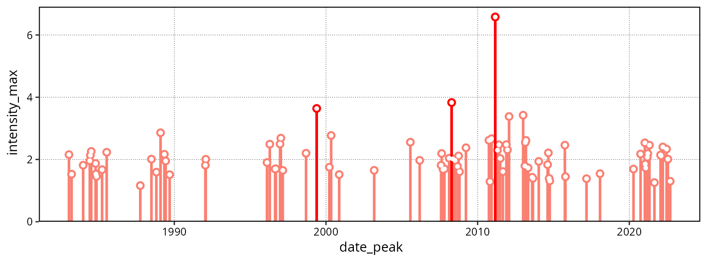

### Custom MHW visuals

The
[`event_line()`](https://robwschlegel.github.io/heatwaveR/reference/event_line.md)
and
[`lolli_plot()`](https://robwschlegel.github.io/heatwaveR/reference/lolli_plot.md)
functions were designed to work directly on the list returned by
[`detect_event()`](https://robwschlegel.github.io/heatwaveR/reference/detect_event.md).
If more control over the figures is required, it may be useful to create
them in **`ggplot2`** by stacking `geoms`. We specifically created two
new **`ggplot2`** `geoms` to reproduce the functionality of
[`event_line()`](https://robwschlegel.github.io/heatwaveR/reference/event_line.md)
and
[`lolli_plot()`](https://robwschlegel.github.io/heatwaveR/reference/lolli_plot.md).
These functions are more general in their functionality and can be used
outside of the **`heatwaveR`** package, too. To apply them to MHWs and
MCSs first requires that we access the `climatology` or `event`
dataframes within the list that is produced by
[`detect_event()`](https://robwschlegel.github.io/heatwaveR/reference/detect_event.md).
Here is how:

``` r

# Select the region of the time series of interest
mhw2 <- mhw$climatology %>% 
  slice(10580:10720)

ggplot(mhw2, aes(x = t, y = temp, y2 = thresh)) +
  geom_flame() +
  geom_text(aes(x = as.Date("2011-02-25"), y = 25.8, label = "the Destroyer\nof Kelps"))
```

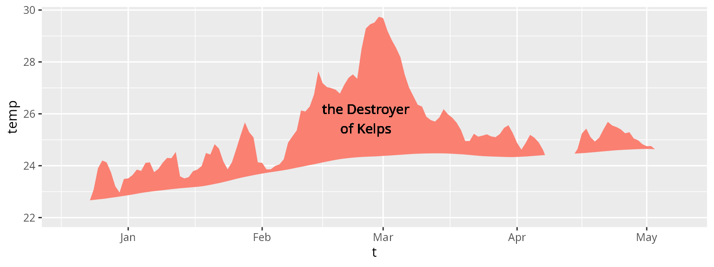

``` r

ggplot(mhw$event, aes(x = date_start, y = intensity_max)) +
  geom_lolli(colour = "salmon", colour_n = "red", n = 3) +
  geom_text(colour = "black", aes(x = as.Date("2006-08-01"), y = 5,
                label = "The marine heatwaves\nTend to be left skewed in a\nGiven time series")) +
  labs(y = expression(paste("Max. intensity [", degree, "C]")), x = NULL)
```

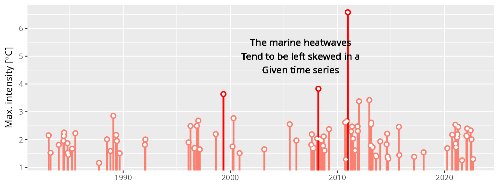

### Spicy MHW visuals

The default output of these function may not be to your liking. If so,
not to worry. As **`ggplot2`** `geoms`, they are highly malleable. For
example, if we were to choose to reproduce the format of the MHWs as
seen in Hobday et al. (2016), the code would look something like this:

``` r

# It is necessary to give geom_flame() at least one row on either side of 
# the event in order to calculate the polygon corners smoothly
mhw_top <- mhw2 %>% 
  slice(5:111)

ggplot(data = mhw2, aes(x = t)) +
  geom_flame(aes(y = temp, y2 = thresh, fill = "all"), show.legend = T) +
  geom_flame(data = mhw_top, aes(y = temp, y2 = thresh, fill = "top"),  show.legend = T) +
  geom_line(aes(y = temp, colour = "temp")) +
  geom_line(aes(y = thresh, colour = "thresh"), size = 1.0) +
  geom_line(aes(y = seas, colour = "seas"), size = 1.2) +
  scale_colour_manual(name = "Line Colour",
                      values = c("temp" = "black", 
                                 "thresh" =  "forestgreen", 
                                 "seas" = "grey80")) +
  scale_fill_manual(name = "Event Colour", 
                    values = c("all" = "salmon", 
                               "top" = "red")) +
  scale_x_date(date_labels = "%b %Y") +
  guides(colour = guide_legend(override.aes = list(fill = NA))) +
  labs(y = expression(paste("Temperature [", degree, "C]")), x = NULL)
```

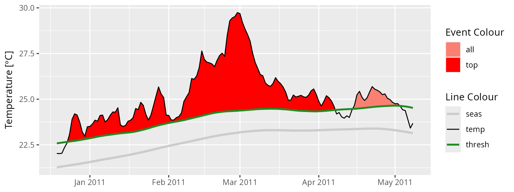

It is also worth pointing out that when we use
[`geom_flame()`](https://robwschlegel.github.io/heatwaveR/reference/geom_flame.md)
directly like this, but we don’t want to highlight events greater less
than our standard five day length, allowing for a two day gap, we want
to use the arguments `n` and `n_gap` respectively.

``` r

mhw3 <- mhw$climatology %>% 
  slice(850:950)

ggplot(mhw3, aes(x = t, y = temp, y2 = thresh)) +
  geom_flame(fill = "black", alpha = 0.5) +
  # Note the use of n = 5 and n_gap = 2 below
  geom_flame(n = 5, n_gap = 2, fill = "red", alpha = 0.5) +
  ylim(c(22, 25)) +
    geom_text(colour = "black", aes(x = as.Date("1984-05-16"), y = 24.5,
                label = "heat\n\n\n\n\nspike"))
```

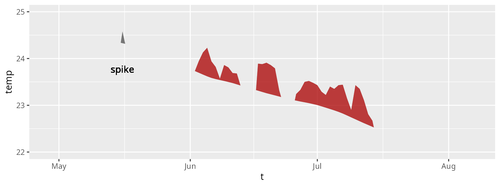

Should we not wish to highlight any events with
[`geom_lolli()`](https://robwschlegel.github.io/heatwaveR/reference/geom_lolli.md),
plot them with a colour other than the default, and use a different
theme, it would look like this:

``` r

ggplot(mhw$event, aes(x = date_peak, y = intensity_max)) +
  geom_lolli(colour = "firebrick") +
  labs(x = "Peak Date", 
       y = expression(paste("Max. intensity [", degree, "C]")), x = NULL) +
  theme_linedraw()
```

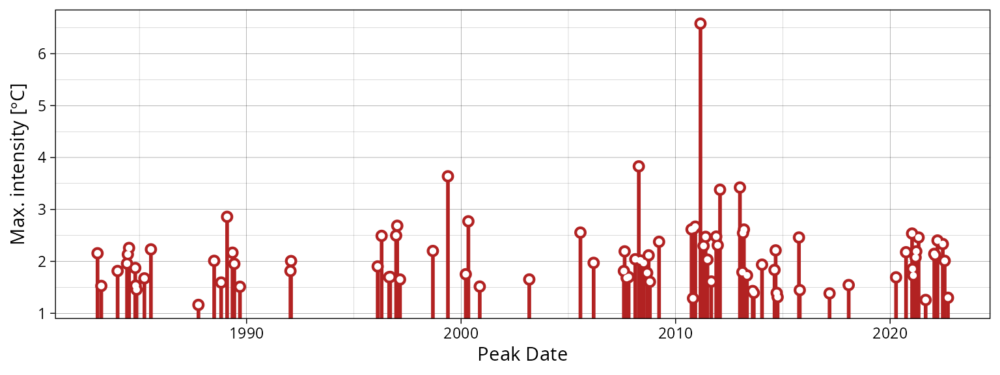

Because these are simple **`ggplot2`** geoms possibilities are nearly
infinite.

## Calculating marine cold-spells (MCSs)

The calculation and visualisation of cold-spells is also provided for
within this package. The data to be fed into the functions is the same
as for MHWs. The main difference is that one is now calculating the 10th
percentile threshold, rather than the 90th percentile threshold. Here
are the top five cold-spells (cumulative intensity) detected in the
OISST data for Western Australia:

``` r

# First calculate the cold-spells
ts_10th <- ts2clm(sst_WA, climatologyPeriod = c("1982-01-01", "2011-12-31"), pctile = 10)
mcs <- detect_event(ts_10th, coldSpells = TRUE)

# Then look at the top few events
mcs$event %>% 
  dplyr::ungroup() %>%
  dplyr::select(event_no, duration, date_start,
                date_peak, intensity_mean, intensity_max, intensity_cumulative) %>%
  dplyr::arrange(intensity_cumulative) %>% 
  head(5)
```

    ##   event_no duration date_start  date_peak intensity_mean intensity_max
    ## 1       15       76 1990-04-13 1990-05-11        -2.5027       -3.1883
    ## 2       49       58 2003-12-19 2004-01-23        -1.7341       -2.5865
    ## 3       83       41 2020-04-26 2020-05-25        -2.3374       -3.1433
    ## 4       64       52 2014-04-14 2014-05-05        -1.7824       -2.5358
    ## 5       77       46 2018-07-24 2018-08-02        -1.8096       -2.4311
    ##   intensity_cumulative
    ## 1            -190.2043
    ## 2            -100.5806
    ## 3             -95.8339
    ## 4             -92.6844
    ## 5             -83.2407

## Visualising marine cold-spells (MCSs)

### Default MCS visuals

The default plots showing cold-spells look like this:

``` r

event_line(mcs, spread = 200, metric = intensity_cumulative,
           start_date = "1982-01-01", end_date = "2014-12-31")
```

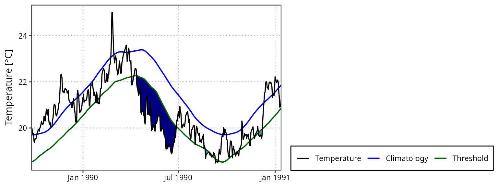

``` r

lolli_plot(mcs, metric = intensity_cumulative, xaxis = event_no)
```

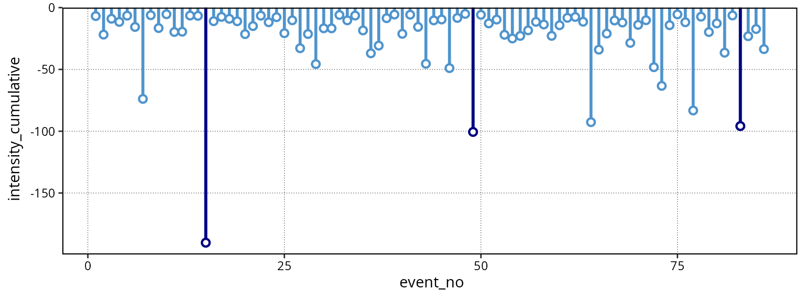

Note that one does not need to specify that MCSs are to be visualised,
the functions are able to understand this on their own.

### Custom MCS visuals

Cold spell figures may be created as `geoms` in **`ggplot2`**, too:

``` r

# Select the region of the time series of interest
mcs2 <- mcs$climatology %>% 
  slice(2900:3190)

# Note that one must specify a colour other than the default 'salmon'
ggplot(mcs2, aes(x = t, y = thresh, y2 = temp)) +
  geom_flame(fill = "steelblue3")
```

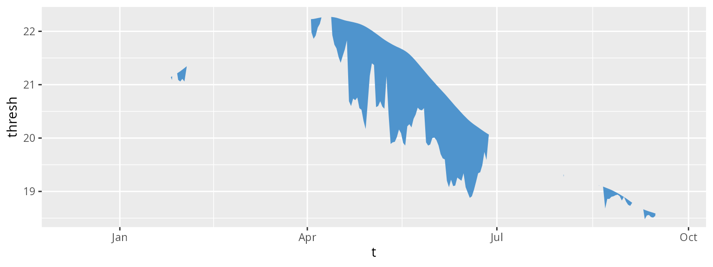

``` r

ggplot(mcs$event, aes(x = date_start, y = intensity_max)) +
  geom_lolli(colour = "steelblue3", colour_n = "navy", n = 3) +
  labs(x = "Start Date",
       y = expression(paste("Max. intensity [", degree, "C]")))
```

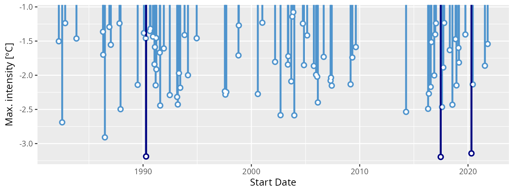

### Minty MCS visuals

Again, because
[`geom_flame()`](https://robwschlegel.github.io/heatwaveR/reference/geom_flame.md)
and
[`geom_lolli()`](https://robwschlegel.github.io/heatwaveR/reference/geom_lolli.md)
are simple **`ggplot2`** geoms, one can go completely bananas with them:

``` r

mcs_top <- mcs2 %>% 
  slice(125:202)

ggplot(data = mcs2, aes(x = t)) +
  geom_flame(aes(y = thresh, y2 = temp, fill = "all"), show.legend = T) +
  geom_flame(data = mcs_top, aes(y = thresh, y2 = temp, fill = "top"), show.legend = T) +
  geom_line(aes(y = temp, colour = "temp")) +
  geom_line(aes(y = thresh, colour = "thresh"), size = 1.0) +
  geom_line(aes(y = seas, colour = "seas"), size = 1.2) +
  scale_colour_manual(name = "Line Colour",
                      values = c("temp" = "black", "thresh" =  "forestgreen", "seas" = "grey80")) +
  scale_fill_manual(name = "Event Colour", values = c("all" = "steelblue3", "top" = "navy")) +
  scale_x_date(date_labels = "%b %Y") +
  guides(colour = guide_legend(override.aes = list(fill = NA))) +
  labs(y = expression(paste("Temperature [", degree, "C]")), x = NULL)
```

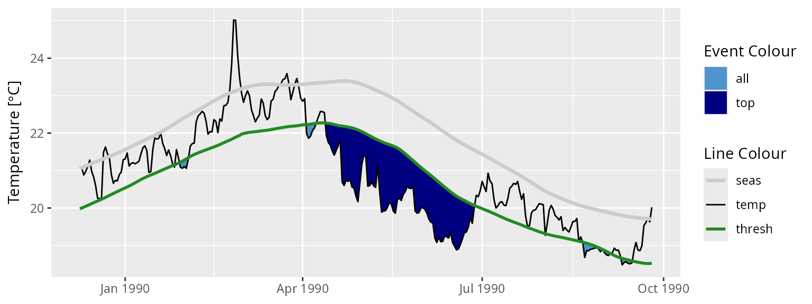

``` r

ggplot(mcs$event, aes(x = date_start, y = intensity_cumulative)) +
  geom_lolli(colour = "steelblue3", colour_n = "navy", n = 7) +
  labs( x = "Start Date", y = expression(paste("Cumulative intensity [days x ", degree, "C]")))
```

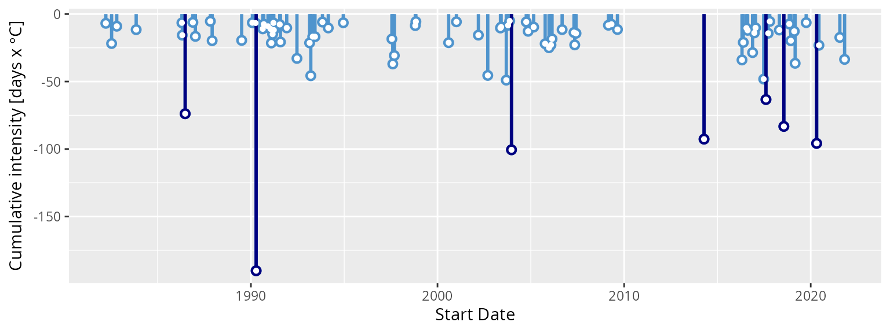

## Interactive visuals

As of **`heatwaveR`** v0.3.6.9002,
[`geom_flame()`](https://robwschlegel.github.io/heatwaveR/reference/geom_flame.md)
was also able to be used with **`plotly`** to allow for interactive MHW
visuals. Unfortunately around December of 2020 the **`plotly`** packaged
was orphaned and CRAN decided it didn’t want packages to include it as
an imported package. Therefore as of v0.4.4.9005 **`heatwaveR`** no
longer has built in support for using
[`geom_flame()`](https://robwschlegel.github.io/heatwaveR/reference/geom_flame.md)
with **`plotly`**. It is however still possible with a bit of work and a
simple working example is given below. It is not currently possible to
use
[`geom_lolli()`](https://robwschlegel.github.io/heatwaveR/reference/geom_lolli.md)
with **`plotly`**. Rather one is advised to just create the dots and
segments separately with
[`geom_point()`](https://ggplot2.tidyverse.org/reference/geom_point.html)
and
[`geom_segment()`](https://ggplot2.tidyverse.org/reference/geom_segment.html)
respectively as these are already recognised by **`plotly`**.

Note that the following code chunk is not run as it makes this vignette
a bit too large.

``` r

# Must load plotly library first
library(plotly)

# Function needed for making geom_flame() work with plotly
geom2trace.GeomFlame <- function (data,
                                  params,
                                  p) {
  
  x <- y <- y2 <- NULL
  
  # Create data.frame for ease of use
  data1 <- data.frame(x = data[["x"]],
                      y = data[["y"]],
                      y2 = data[["y2"]])
  
  # Grab parameters
  n <- params[["n"]]
  n_gap <- params[["n_gap"]]
  
  # Find events that meet minimum length requirement
  data_event <- heatwaveR::detect_event(data1, x = x, y = y,
                                        seasClim = y,
                                        threshClim = y2,
                                        minDuration = n,
                                        maxGap = n_gap,
                                        protoEvents = T)
  
  # Detect spikes
  data_event$screen <- base::ifelse(data_event$threshCriterion == FALSE, FALSE,
                                    ifelse(data_event$event == FALSE, TRUE, FALSE))
  
  # Screen out spikes
  data1 <- data1[data_event$screen != TRUE,]
  
  # Prepare to find the polygon corners
  x1 <- data1$y
  x2 <- data1$y2
  
  # # Find points where x1 is above x2.
  above <- x1 > x2
  above[above == TRUE] <- 1
  above[is.na(above)] <- 0
  
  # Points always intersect when above=TRUE, then FALSE or reverse
  intersect.points <- which(diff(above) != 0)
  
  # Find the slopes for each line segment.
  x1.slopes <- x1[intersect.points + 1] - x1[intersect.points]
  x2.slopes <- x2[intersect.points + 1] - x2[intersect.points]
  
  # # Find the intersection for each segment.
  x.points <- intersect.points + ((x2[intersect.points] - x1[intersect.points]) / (x1.slopes - x2.slopes))
  y.points <- x1[intersect.points] + (x1.slopes * (x.points - intersect.points))
  
  # Coerce x.points to the same scale as x
  x_gap <- data1$x[2] - data1$x[1]
  x.points <- data1$x[intersect.points] + (x_gap*(x.points - intersect.points))
  
  # Create new data frame and merge to introduce new rows of data
  data2 <- data.frame(y = c(data1$y, y.points), x = c(data1$x, x.points))
  data2 <- data2[order(data2$x),]
  data3 <- base::merge(data1, data2, by = c("x","y"), all.y = T)
  data3$y2[is.na(data3$y2)] <- data3$y[is.na(data3$y2)]
  
  # Remove missing values for better plotting
  data3$y[data3$y < data3$y2] <- NA
  missing_pos <- !stats::complete.cases(data3[c("x", "y", "y2")])
  ids <- cumsum(missing_pos) + 1
  ids[missing_pos] <- NA
  
  # Get the correct positions
  positions <- data.frame(x = c(data3$x, rev(data3$x)),
                          y = c(data3$y, rev(data3$y2)),
                          ids = c(ids, rev(ids)))
  
  # Convert to a format geom2trace is happy with
  positions <- plotly::group2NA(positions, groupNames = "ids")
  positions <- positions[stats::complete.cases(positions$ids),]
  positions <- dplyr::left_join(positions, data[,-c(2,3)], by = "x")
  if(length(stats::complete.cases(positions$PANEL)) > 1) 
    positions$PANEL <- positions$PANEL[stats::complete.cases(positions$PANEL)][1]
  if(length(stats::complete.cases(positions$group)) > 1) 
    positions$group <- positions$group[stats::complete.cases(positions$group)][1]
  
  # Run the plotly polygon code
  if(length(unique(positions$PANEL)) == 1){
    getFromNamespace("geom2trace.GeomPolygon", asNamespace("plotly"))(positions)
  } else{
    return()
  }
}

# Time series
ts_res <- heatwaveR::ts2clm(data = heatwaveR::sst_WA,
                            climatologyPeriod = c("1982-01-01", "2011-12-31"))
ts_res_sub <- ts_res[10500:10800,]

# Flame Figure
p <- ggplot(data = ts_res_sub, aes(x = t, y = temp)) +
  heatwaveR::geom_flame(aes(y2 = thresh), n = 5, n_gap = 2) +
  geom_line(aes(y = temp)) +
  geom_line(aes(y = seas), colour = "green") +
  geom_line(aes(y = thresh), colour = "red") +
  labs(x = "", y = "Temperature (°C)")

# Create interactive visuals
ggplotly(p)
```
