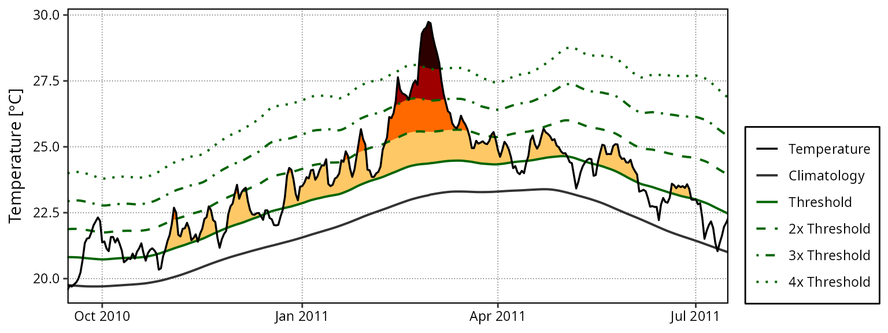
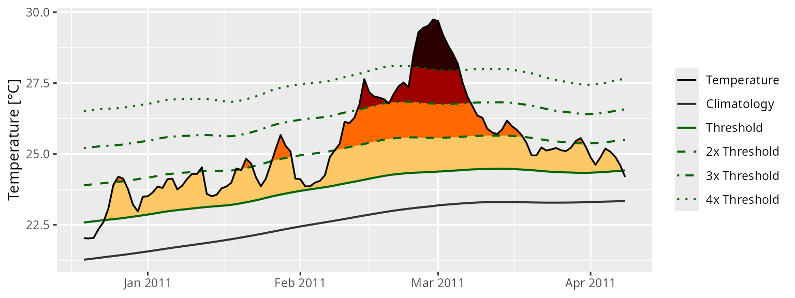
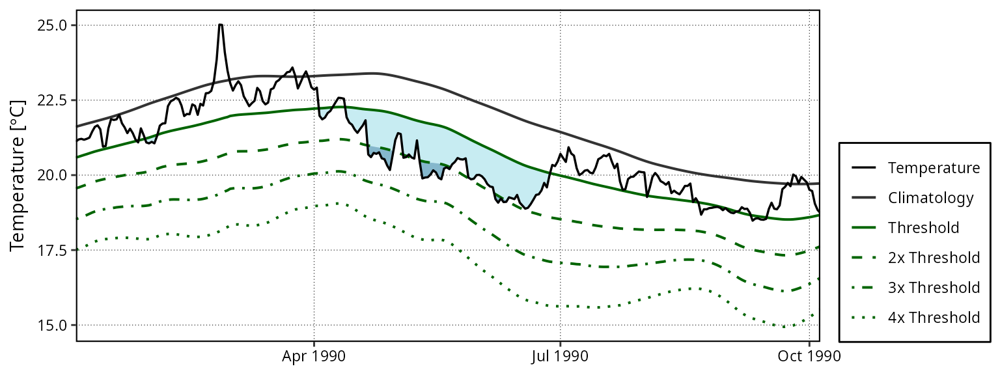
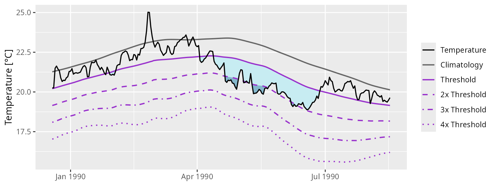
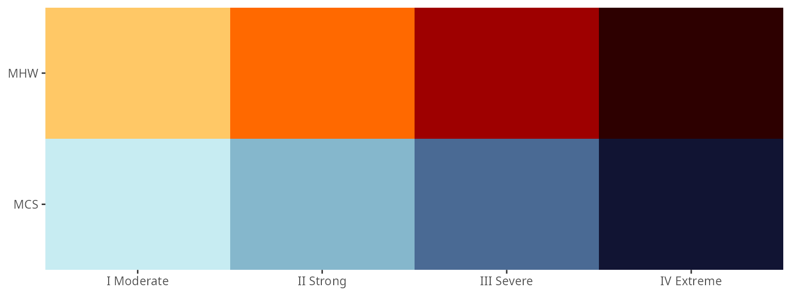

# Calculating and Visualising Event Categories

## Categories

In Hobday et al. (2018) a naming convention for MHWs was proposed that
divides them into four categories based on their maximum observed
intensity. The naming convention and a brief description are as follows:

| Category | Description |
|----|----|
| I Moderate | Events that have been detected, but with a maximum intensity that does not double the distance between the seasonal climatology and the threshold value. These are common and not terribly worrisome. |
| II Strong | Events with a maximum intensity that doubles the distance from the seasonal climatology to the threshold, but does not triple it. These are not uncommon, but have yet to be shown to cause any long term biological or ecological damage. |
| III Severe | Thankfully these are relatively uncommon as they have been linked to damaging events. The 2003 Mediterranean MHW was this category. |
| IV Extreme | Events with a maximum intensity that is four times or greater than the aforementioned distance. These events are currently rare, but are projected to increase with frequency. This is troubling as events in this category are now well documented as causing widespread and lasting ecological damage. The 2011 Western Australia MHW was this category. It is also the logo of this package. |

## Calculating MHW categories

The categories of MHWs under the Hobday et al. (2018) naming scheme may
be calculated with the **`heatwaveR`** package using the
[`category()`](https://robwschlegel.github.io/heatwaveR/index.html/reference/category.md)
function on the output of the
[`detect_event()`](https://robwschlegel.github.io/heatwaveR/index.html/reference/detect_event.md)
function. By default this function will order events from most to least
intense. Note that one may control the output for the names of the
events by providing ones own character string for the `name` argument.
Because we have calculated MHWs on the Western Australia data, we
provide the name “WA” below:

``` r
# Load libraries
library(dplyr)
library(tidyr)
library(ggplot2)
library(heatwaveR)

# Calculate events
ts <- ts2clm(sst_WA, climatologyPeriod = c("1982-01-01", "2011-12-31"))
MHW <- detect_event(ts) 
MHW_cat <- category(MHW, S = TRUE, name = "WA")

# Look at the top few events
tail(MHW_cat)
```

    ##    event_no event_name  peak_date   category  i_max duration p_moderate
    ## 85       60   WA 2012b 2012-12-31  II Strong 3.4230       14         64
    ## 86       29    WA 1999 1999-05-22  II Strong 3.6390       95         63
    ## 87       47    WA 2009 2009-03-25  II Strong 2.3773        7         57
    ## 88       72    WA 2015 2015-10-02  II Strong 2.4604        7         57
    ## 89       41   WA 2008a 2008-04-14 III Severe 3.8299       35         57
    ## 90       52   WA 2011a 2011-02-28 IV Extreme 6.5798      105         52
    ##    p_strong p_severe p_extreme        season
    ## 85       36        0         0 Spring/Summer
    ## 86       37        0         0   Fall/Winter
    ## 87       43        0         0        Summer
    ## 88       43        0         0 Winter/Spring
    ## 89       23       17         0   Summer/Fall
    ## 90       27       11        10   Spring-Fall

Note that this functions expects the data to have been collected in the
southern hemisphere, hence the argument `S = TRUE`. If they were not,
one must set `S = FALSE` as seen in the example below. This ensures that
the correct seasons are attributed to the event.

``` r
res_Med <- detect_event(ts2clm(sst_Med, climatologyPeriod = c("1982-01-01", "2011-12-31")))
res_Med_cat <- category(res_Med, S = FALSE, name = "Med")
tail(res_Med_cat)
```

    ##     event_no event_name  peak_date   category  i_max duration p_moderate
    ## 118       98  Med 2018b 2018-08-04  II Strong 4.7451       44         52
    ## 119      123  Med 2022c 2022-11-03  II Strong 3.5030       74         46
    ## 120       67  Med 2012b 2012-08-20  II Strong 4.3190       18         44
    ## 121       46  Med 2007c 2007-04-25 III Severe 4.0467       19         42
    ## 122       75   Med 2014 2014-10-18  II Strong 3.3443      144         39
    ## 123       96  Med 2018a 2018-04-28  II Strong 3.3185       11         27
    ##     p_strong p_severe p_extreme        season
    ## 118       48        0         0        Summer
    ## 119       53        0         0          Fall
    ## 120       56        0         0        Summer
    ## 121       53        5         0        Spring
    ## 122       60        0         0 Summer-Winter
    ## 123       73        0         0        Spring

## Multiple time series

If however we may want to determine the categories of event within a set
of time series that cross over the equator, we may set the argument
`lat_col = TRUE` to allow
[`category()`](https://robwschlegel.github.io/heatwaveR/index.html/reference/category.md)
to automagically detect the latitude of the events by searching for
columns named either ‘lat’ or ’latitude. See the vignette for [detecting
events in gridded
data](https://robwschlegel.github.io/heatwaveR/articles/gridded_event_detection.html)
for more examples of running **`heatwaveR`** code on gridded data.

``` r
# Add lon/lat to the three default time series
ts_WA <- sst_WA |> mutate(site = "WA", lon = 112.625, lat = -29.375)
ts_NW_Atl <- sst_NW_Atl |> mutate(site = "NW_Atl", lon = -66.875, lat = 43.125)
ts_Med <- sst_Med |> mutate(site = "Med", lon = 9.125, lat = 43.625)
ts_ALL <- rbind(ts_WA, ts_NW_Atl, ts_Med)

# Calculate MHW categories by site
MHW_cat_ALL <- ts_ALL |> 
  group_by(site) |> 
  group_modify(~ {
    .x |> 
      ts2clm(climatologyPeriod = c("1982-01-01", "2011-12-31")) |> 
      detect_event() |> 
      category(season = "peak", lat_col = TRUE)
    }) |> 
  # Correct event names by site
  mutate(event_name = case_when(!is.na(event_name) ~ stringr::str_replace(event_name, "Event", site)))

# View results
MHW_cat_ALL |> 
  arrange(-duration) |> 
  filter(!is.na(event_name)) |> 
  group_by(site) |> 
  group_modify(~ head(.x, 2L)) |> 
  dplyr::select(site:category, duration, season)
```

    ## # A tibble: 6 × 7
    ## # Groups:   site [3]
    ##   site   event_no event_name   peak_date  category   duration season
    ##   <chr>     <int> <chr>        <date>     <chr>         <dbl> <chr> 
    ## 1 Med          75 Med 2014     2014-10-18 II Strong       144 Fall  
    ## 2 Med         122 Med 2022b    2022-07-20 II Strong        79 Summer
    ## 3 NW_Atl       72 NW_Atl 2012c 2012-07-15 II Strong       239 Summer
    ## 4 NW_Atl      100 NW_Atl 2018a 2018-01-12 III Severe      171 Winter
    ## 5 WA           52 WA 2011a     2011-02-28 IV Extreme      105 Summer
    ## 6 WA           59 WA 2012a     2012-01-27 II Strong       101 Summer

## Visualising MHW categories

### Default MHW category visuals

A quick and easy visualisation of the categories of a MHW may be
accomplished with
[`event_line()`](https://robwschlegel.github.io/heatwaveR/index.html/reference/event_line.md)
by setting the `category` argument to `TRUE`.

``` r
event_line(MHW, spread = 100, start_date = "2010-11-01", end_date = "2011-06-30", category = TRUE)
```



### Custom MHW category visuals

Were one to want to visualise the categories of a MHW ‘by hand’, the
following code will provide a good starting point.

``` r
# Create category breaks and select slice of data.frame
clim_cat <- MHW$clim %>%
  dplyr::mutate(diff = thresh - seas,
                thresh_2x = thresh + diff,
                thresh_3x = thresh_2x + diff,
                thresh_4x = thresh_3x + diff) %>% 
  dplyr::slice(10580:10690)

# Set line colours
lineColCat <- c(
  "Temperature" = "black",
  "Climatology" = "gray20",
  "Threshold" = "darkgreen",
  "2x Threshold" = "darkgreen",
  "3x Threshold" = "darkgreen",
  "4x Threshold" = "darkgreen"
  )

# Set category fill colours
fillColCat <- c(
  "Moderate" = "#ffc866",
  "Strong" = "#ff6900",
  "Severe" = "#9e0000",
  "Extreme" = "#2d0000"
  )

ggplot(data = clim_cat, aes(x = t, y = temp)) +
  geom_flame(aes(y2 = thresh, fill = "Moderate")) +
  geom_flame(aes(y2 = thresh_2x, fill = "Strong")) +
  geom_flame(aes(y2 = thresh_3x, fill = "Severe")) +
  geom_flame(aes(y2 = thresh_4x, fill = "Extreme")) +
  geom_line(aes(y = thresh_2x, col = "2x Threshold"), size = 0.7, linetype = "dashed") +
  geom_line(aes(y = thresh_3x, col = "3x Threshold"), size = 0.7, linetype = "dotdash") +
  geom_line(aes(y = thresh_4x, col = "4x Threshold"), size = 0.7, linetype = "dotted") +
  geom_line(aes(y = seas, col = "Climatology"), size = 0.7) +
  geom_line(aes(y = thresh, col = "Threshold"), size = 0.7) +
  geom_line(aes(y = temp, col = "Temperature"), size = 0.6) +
  scale_colour_manual(name = NULL, values = lineColCat,
                      breaks = c("Temperature", "Climatology", "Threshold",
                                 "2x Threshold", "3x Threshold", "4x Threshold")) +
  scale_fill_manual(name = NULL, values = fillColCat, guide = FALSE) +
  scale_x_date(date_labels = "%b %Y") +
  guides(colour = guide_legend(override.aes = list(linetype = c("solid", "solid", "solid",
                                                                "dashed", "dotdash", "dotted"),
                                                   size = c(0.6, 0.7, 0.7, 0.7, 0.7, 0.7)))) +
  labs(y = "Temperature [°C]", x = NULL)
```



## Calculating MCS categories

MCSs are calculated the same as for MHWs. The
[`category()`](https://robwschlegel.github.io/heatwaveR/index.html/reference/category.md)
function will automagically detect if it has been fed MHWs or MCSs so no
additional arguments are required. For the sake of clarity the following
code chunks demonstrates how to calculate MCS categories.

``` r
# Calculate events
ts_MCS <- ts2clm(sst_WA, climatologyPeriod = c("1982-01-01", "2011-12-31"), pctile = 10)
MCS <- detect_event(ts_MCS, coldSpells = T)
MCS_cat <- category(MCS, S = TRUE, name = "WA")

# Look at the top few events
tail(MCS_cat)
```

    ##    event_no event_name  peak_date  category   i_max duration p_moderate
    ## 81       77   WA 2018a 2018-08-02 II Strong -2.4311       46         67
    ## 82       40    WA 2000 2000-08-13 II Strong -2.2743       11         64
    ## 83       15    WA 1990 1990-05-11 II Strong -3.1883       76         62
    ## 84       53    WA 2005 2005-10-16 II Strong -1.8637       13         62
    ## 85       83    WA 2020 2020-05-25 II Strong -3.1433       41         61
    ## 86       11    WA 1987 1987-12-10 II Strong -2.4968        9         44
    ##    p_strong p_severe p_extreme season
    ## 81       33        0         0 Winter
    ## 82       36        0         0 Winter
    ## 83       38        0         0   Fall
    ## 84       38        0         0 Spring
    ## 85       39        0         0   Fall
    ## 86       56        0         0 Spring

## Visualising MCS categories

### Default MCS category visuals

The
[`event_line()`](https://robwschlegel.github.io/heatwaveR/index.html/reference/event_line.md)
function also works for visualising MCS categories. The function will
automagically detect that it is being fed MCSs so we do not need to
provide it with any new arguments. Note that the colour palette for MCS
does have four colours, same as for MHWs, but none of the demo time
series that come packaged with **`heatwaveR`** have MCSs that intense so
we are not able to demonstrate the full colour palette here.

``` r
event_line(MCS, spread = 100, start_date = "1989-11-01", end_date = "1990-06-30", category = TRUE)
```



### Custom MCS category visuals

The following code chunk demonstrates how to manually create a figure
showing the MCS categories.

``` r
# Create category breaks and select slice of data.frame
MCS_clim_cat <- MCS$clim %>%
  dplyr::mutate(diff = thresh - seas,
                thresh_2x = thresh + diff,
                thresh_3x = thresh_2x + diff,
                thresh_4x = thresh_3x + diff) %>% 
  dplyr::slice(2910:3150)

# Set line colours
lineColCat <- c(
  "Temperature" = "black",
  "Climatology" = "grey40",
  "Threshold" = "darkorchid",
  "2x Threshold" = "darkorchid",
  "3x Threshold" = "darkorchid",
  "4x Threshold" = "darkorchid"
  )

# Set category fill colours
fillColCat <- c(
  "Moderate" = "#C7ECF2",
  "Strong" = "#85B7CC",
  "Severe" = "#4A6A94",
  "Extreme" = "#111433"
  )

# Create plot
ggplot(data = MCS_clim_cat, aes(x = t, y = temp)) +
  geom_flame(aes(y = thresh, y2 = temp, fill = "Moderate")) +
  geom_flame(aes(y = thresh_2x, y2 = temp, fill = "Strong")) +
  geom_flame(aes(y = thresh_3x, y2 = temp, fill = "Severe")) +
  geom_flame(aes(y = thresh_4x, y2 = temp, fill = "Extreme")) +
  geom_line(aes(y = thresh_2x, col = "2x Threshold"), size = 0.7, linetype = "dashed") +
  geom_line(aes(y = thresh_3x, col = "3x Threshold"), size = 0.7, linetype = "dotdash") +
  geom_line(aes(y = thresh_4x, col = "4x Threshold"), size = 0.7, linetype = "dotted") +
  geom_line(aes(y = seas, col = "Climatology"), size = 0.7) +
  geom_line(aes(y = thresh, col = "Threshold"), size = 0.7) +
  geom_line(aes(y = temp, col = "Temperature"), size = 0.6) +
  scale_colour_manual(name = NULL, values = lineColCat,
                      breaks = c("Temperature", "Climatology", "Threshold",
                                 "2x Threshold", "3x Threshold", "4x Threshold")) +
  scale_fill_manual(name = NULL, values = fillColCat, guide = FALSE) +
  scale_x_date(date_labels = "%b %Y") +
  guides(colour = guide_legend(override.aes = list(linetype = c("solid", "solid", "solid",
                                                                "dashed", "dotdash", "dotted"),
                                                   size = c(0.6, 0.7, 0.7, 0.7, 0.7, 0.7)))) +
  labs(y = "Temperature [°C]", x = NULL)
```



## Category colour palettes

For the sake of convenience the MHW and MCS colour palettes are provided
below with a figure showing the direct comparison.

``` r
# The MCS colour palette
MCS_colours <- c(
  "Moderate" = "#C7ECF2",
  "Strong" = "#85B7CC",
  "Severe" = "#4A6A94",
  "Extreme" = "#111433"
)

# The MHW colour palette
MHW_colours <- c(
  "Moderate" = "#ffc866",
  "Strong" = "#ff6900",
  "Severe" = "#9e0000",
  "Extreme" = "#2d0000"
)

# Create the colour palette for plotting by itself
colour_palette <- data.frame(category = factor(c("I Moderate", "II Strong", "III Severe", "IV Extreme"),
                                               levels = c("I Moderate", "II Strong", "III Severe", "IV Extreme")),
                             MHW = c(MHW_colours[1], MHW_colours[2], MHW_colours[3], MHW_colours[4]),
                             MCS = c(MCS_colours[1], MCS_colours[2], MCS_colours[3], MCS_colours[4])) %>% 
  pivot_longer(cols = c(MHW, MCS), names_to = "event", values_to = "colour")

# Show the palettes side-by-side
ggplot(data = colour_palette, aes(x = category, y = event)) +
  geom_tile(fill = colour_palette$colour) +
  coord_cartesian(expand = F) +
  labs(x = NULL, y = NULL)
```


