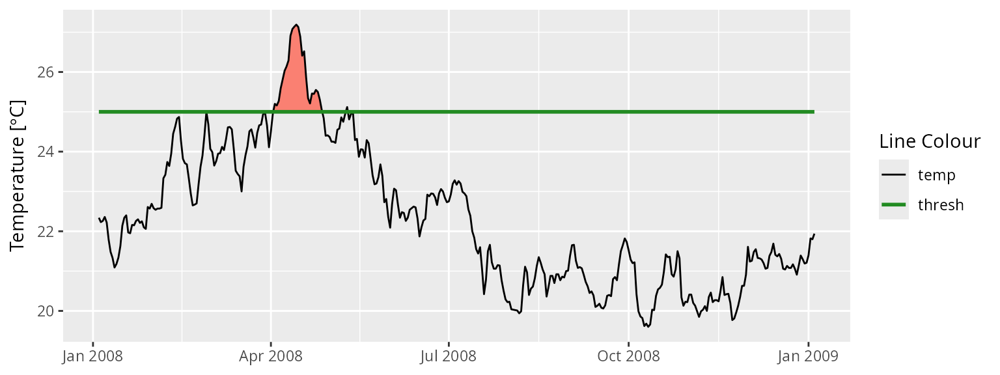
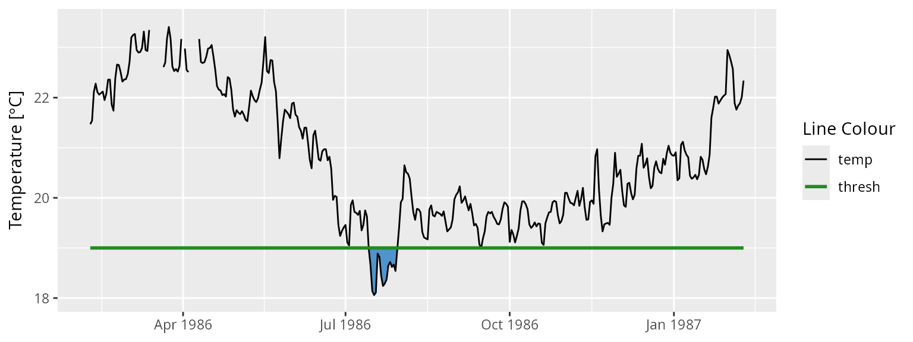

# Calculating and Visualising Exceedances

## Exceedances

In addition to the calculation of events based on a given percentile,
this package also allows for the calculation of events based on a given
static threshold with the
[`exceedance()`](https://robwschlegel.github.io/heatwaveR/reference/exceedance.md)
function. This is most useful if one is more interested in testing a
time series for events that exceed a pre-determined static threshold
that is already known to be of particular significance in a given part
of the world. The output of this function may also be used in the
calculation of events that may require two thresholds, such as
atmospheric events with ‘tMin’ and ‘tMax’ daily values. For a detailed
explanation for how to do this please see [this
vignette](https://robwschlegel.github.io/heatwaveR/articles/complex_clims.html).
The data requirements for
[`exceedance()`](https://robwschlegel.github.io/heatwaveR/reference/exceedance.md)
are the same as for
[`ts2clm()`](https://robwschlegel.github.io/heatwaveR/reference/ts2clm.md)
and
[`detect_event()`](https://robwschlegel.github.io/heatwaveR/reference/detect_event.md).

## Calculating exceedances

The calculation of exceedances may be done with only one function as
seen here:

``` r

# Activate libraries
library(dplyr)
library(ggplot2)
library(heatwaveR)

# Calculate exceedence
exc_25 <- exceedance(sst_WA, threshold = 25)

# Look at a few metrics
exc_25$exceedance %>%
  ungroup() %>%
  select(exceedance_no, duration, date_start, date_peak, intensity_max, intensity_cumulative) %>%
  dplyr::arrange(-intensity_cumulative) %>%
  head(5)
```

    ##   exceedance_no duration date_start  date_peak intensity_max
    ## 1             7       52 2011-02-08 2011-02-28          4.74
    ## 2             6       25 2008-04-03 2008-04-14          2.19
    ## 3            10       41 2012-03-03 2012-04-10          1.37
    ## 4             2       17 1999-05-13 1999-05-22          1.40
    ## 5             5       10 2000-05-03 2000-05-04          1.01
    ##   intensity_cumulative
    ## 1                87.05
    ## 2                24.50
    ## 3                17.98
    ## 4                14.55
    ## 5                 6.97

Note that the resultant output of
[`exceedance()`](https://robwschlegel.github.io/heatwaveR/reference/exceedance.md)
is very similar to
[`detect_event()`](https://robwschlegel.github.io/heatwaveR/reference/detect_event.md),
except that the two dataframes within the list are called `threshold`
and `exceedance`, rather than `climatology` and `event`.

## Visualising exceedances

Because
[`event_line()`](https://robwschlegel.github.io/heatwaveR/reference/event_line.md)
and
[`lolli_plot()`](https://robwschlegel.github.io/heatwaveR/reference/lolli_plot.md)
are designed to work on the output of
[`detect_event()`](https://robwschlegel.github.io/heatwaveR/reference/detect_event.md),
if we want to visualise the results of
[`exceedance()`](https://robwschlegel.github.io/heatwaveR/reference/exceedance.md)
we will need to do so ‘by hand’ with **`ggplot2`**. The code below works
as an example of how to do so:

``` r

exc_25_thresh <- exc_25$threshold %>% 
  slice(9500:9866)

ggplot(data = exc_25_thresh, aes(x = t)) +
  geom_flame(aes(y = temp, y2 = thresh, fill = "all"), show.legend = F) +
  geom_line(aes(y = temp, colour = "temp")) +
  geom_line(aes(y = thresh, colour = "thresh"), size = 1.0) +
  scale_colour_manual(name = "Line Colour",
                      values = c("temp" = "black", "thresh" =  "forestgreen")) +
  scale_fill_manual(name = "Event Colour", values = c("all" = "salmon")) +
  guides(colour = guide_legend(override.aes = list(fill = NA))) +
  scale_x_date(date_labels = "%b %Y") +
  labs(y = expression(paste("Temperature [", degree, "C]")), x = NULL)
```



## Calculating negative exceedances

Unfortunately there is no antonym for exceedance in the English
language, which makes talking about exceedances *below* a static
threshold somewhat awkward. For the purposes of clarity here we will
refer to these as negative exceedances.

The
[`exceedance()`](https://robwschlegel.github.io/heatwaveR/reference/exceedance.md)
function may be used to calculate consecutive days below a threshold as
seen here:

``` r

exc_19 <- exceedance(sst_WA, threshold = 19, below = TRUE)
exc_19$exceedance %>%
  dplyr::ungroup() %>%
  dplyr::select(exceedance_no, duration, date_start, date_peak, intensity_mean, intensity_cumulative) %>%
  dplyr::arrange(intensity_cumulative) %>%
  head(5)
```

    ##   exceedance_no duration date_start  date_peak intensity_mean
    ## 1            28       61 2017-08-09 2017-08-20        -0.6092
    ## 2            30       65 2018-07-27 2018-08-22        -0.5302
    ## 3            16       30 2002-09-09 2002-09-25        -0.8763
    ## 4            17       34 2003-09-06 2003-09-16        -0.7526
    ## 5            13       24 1997-09-03 1997-09-15        -0.7692
    ##   intensity_cumulative
    ## 1               -37.16
    ## 2               -34.46
    ## 3               -26.29
    ## 4               -25.59
    ## 5               -18.46

## Visualising negative exceedances

Were one to desire a visualisation of these data it could be produced
with the following code:

``` r

exc_19_thresh <- exc_19$threshold %>% 
  slice(1500:1866)

ggplot(data = exc_19_thresh, aes(x = t)) +
  geom_flame(aes(y = thresh, y2 = temp), fill = "steelblue3", show.legend = F) +
  geom_line(aes(y = temp, colour = "temp")) +
  geom_line(aes(y = thresh, colour = "thresh"), size = 1.0) +
  scale_colour_manual(name = "Line Colour",
                      values = c("temp" = "black", "thresh" =  "forestgreen")) +
  scale_y_continuous(limits = c(18, 23.5)) +
  scale_x_date(date_labels = "%b %Y") +
  labs(y = expression(paste("Temperature [", degree, "C]")), x = NULL)
```


